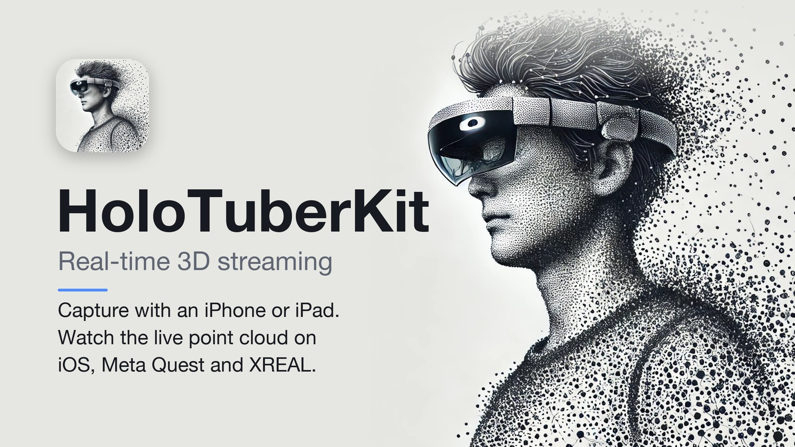
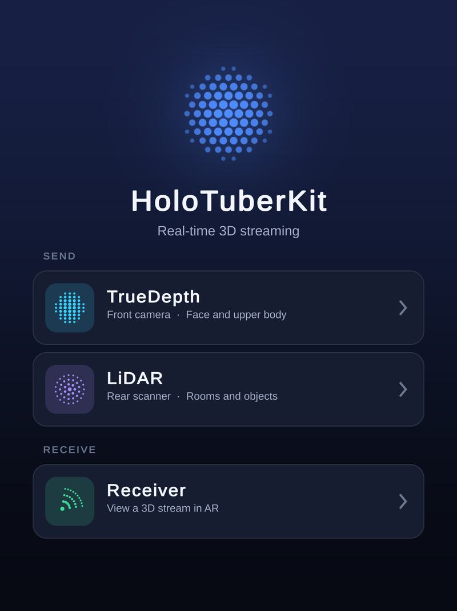
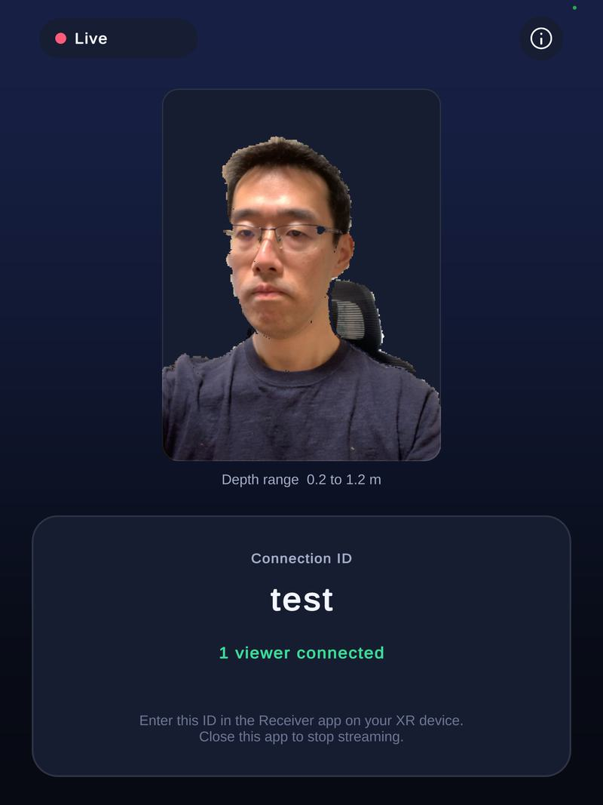
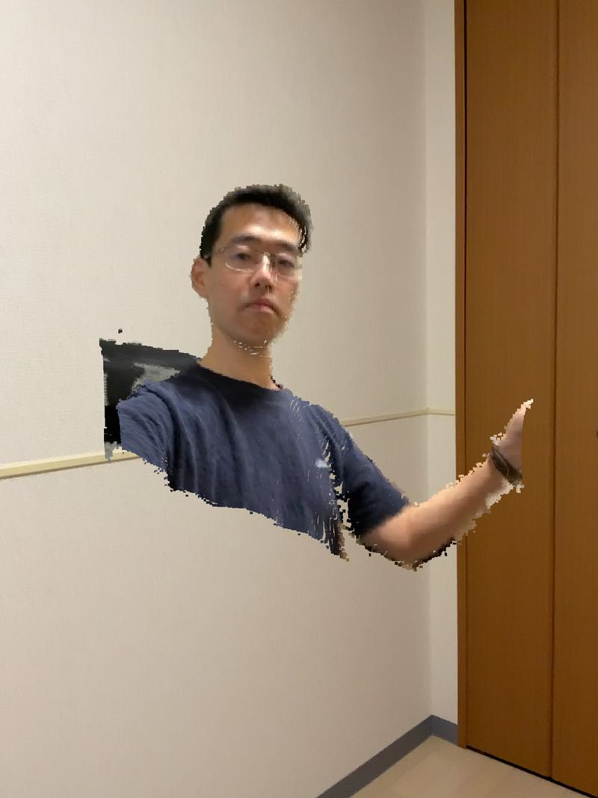
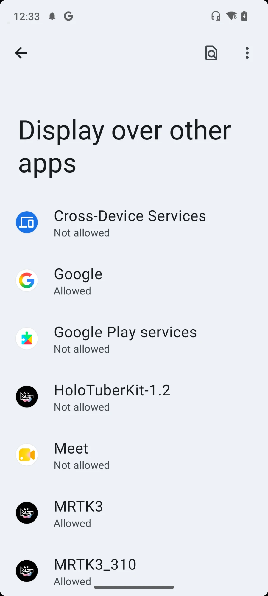
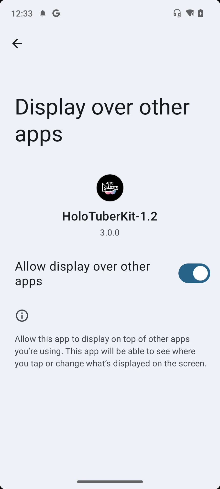
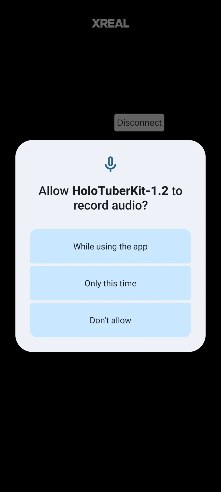

# HoloTuberKit

**Real-time 3D streaming.** Capture yourself (or a room) as a color + depth video on an iPhone / iPad, and watch it as a live point cloud in AR / MR on another device.

Web page: https://holotuberkit.github.io/HoloTuberKit-RealTime/

## Download

| Role | Device | Get it |
| --- | --- | --- |
| **Sender** (capture) and **Receiver** | iPhone / iPad | [App Store](https://apps.apple.com/jp/app/holotuberkit/id6449902663) |
| **Receiver** | Meta Quest 2 / Pro / 3 / 3S | [Meta Quest (beta)](https://www.meta.com/s/6tzXXzKuJ) |
| **Receiver** | XREAL glasses + XREAL Beam Pro | [APK (GitHub Releases)](https://github.com/HoloTuberKit/HoloTuberKit-RealTime/releases/download/v2.0.0/HoloTuberKit_XREAL-1_2_0.apk) |

The iOS app contains both the Sender and the Receiver.
Quest and XREAL users need the **latest iOS app** (it adds LiDAR support).

## How it works

1. The **Sender** (iPhone / iPad) captures color and depth with the **TrueDepth** camera (front, for faces and upper bodies) or the **LiDAR** scanner (rear, for rooms and objects).
2. The frames are streamed over WebRTC, identified by a **Connection ID** that you choose.
3. A **Receiver** enters the same Connection ID and shows the stream as a live point cloud.

## Requirements

- **Sender**: iPhone X or newer / iPad Pro for TrueDepth. iPhone Pro / iPad Pro with a LiDAR scanner for LiDAR. iOS 15 or later.
- **iOS Receiver**: a device that supports ARKit. iOS 15 or later.
- **Meta Quest Receiver**: Quest 2, Quest Pro, Quest 3 or Quest 3S. Sign-in with the Meta account used on your Quest is required, because the app is distributed as a beta test.
- **XREAL Receiver**: XREAL Air 2 Ultra (hand tracking is used) connected to an XREAL Beam Pro. Other Android phones, such as Galaxy, are no longer supported.
- Both devices need an Internet connection.

## How to use

### 1. Sender (iOS)

1. Open **HoloTuberKit** and choose **TrueDepth** or **LiDAR** under **SEND**.
2. Enter a unique **Connection ID**. Take care not to use an ID that another user is already using.
3. Tap **Connect**. Capturing and streaming start, and the screen shows how many viewers are connected.
4. Close the app to stop streaming.

### 2. Receiver

Enter the same Connection ID and connect.

- **iOS**: choose **Receiver** on the home screen, enter the ID and tap **Connect**.
- **Meta Quest**: launch the app and press **Connect** on the panel attached to your left controller. Type the ID in the window that appears, then press **Connect** again. Use **Manipulation: ON** to move and rotate the point cloud (grab it with the controller ray; the thumbstick rotates it around the vertical axis).
- **XREAL**: see below. Enter the ID on the Beam Pro screen and tap **Connect**.

## XREAL: first-time setup

1. **Allow "Display over other apps".** After installing, launch the app. The Android settings screen for *Display over other apps* appears (step 1). Select **HoloTuberKit**, turn on **Allow display over other apps** (step 2), then press the back button.

    

2. **Allow the microphone.** The first time the app starts, a permission dialog appears (step 3). Choose **While using the app**.

   

3. **If hand tracking does not work.** On the very first launch, hand tracking may fail, so you cannot interact and no hand object appears at your hand position. In that case, **disconnect the XREAL glasses from the XREAL Beam Pro (just unplug the USB cable), connect them again, and launch the app again.**

## Known issues

- **Connection error.** In highly secure network environments the device's IP address cannot be obtained, and the point cloud cannot be streamed. Use tethering from a smartphone or another network.

## Privacy

See [Privacy](Privacy/README.md).

## Feedback

I'm glad to get feedback. Tag me or use the hash tag **#HoloTuberKit** when you share a video of your experience.

- X (Twitter): [@Tks_Yoshinaga](https://twitter.com/Tks_Yoshinaga)
- LinkedIn: [Takashi Yoshinaga](https://www.linkedin.com/in/tks-yoshinaga/?locale=en_US)
- Discord: the HoloTuberKit channel of AR_Fukuoka: https://discord.gg/XzrPmgGbfn
